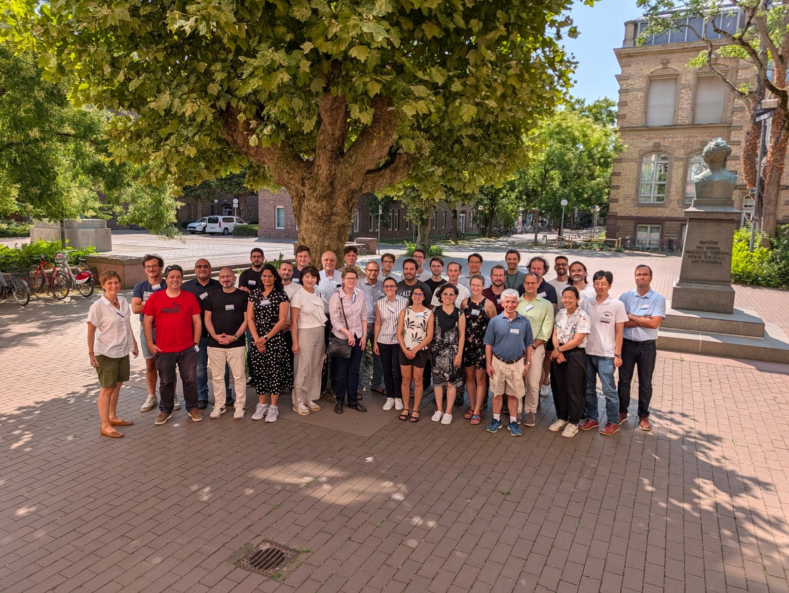
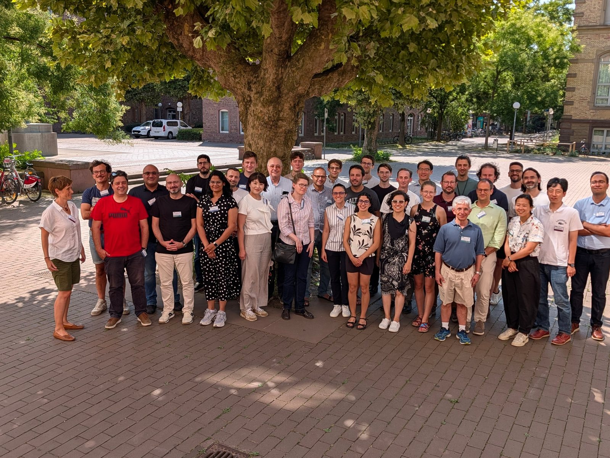

On 26–27 July, I had the pleasure of attending the **First International Roughness Workshop** at the Institute of Fluid Mechanics (ISTM), Karlsruhe Institute of Technology, organized by Bettina Frohnapfel and Alexander Stroh. It was an excellent opportunity to sit in one room with colleagues from all around the world who are working on the same problem: **surface roughness in wall-bounded turbulence**.

*Participants of the First International Roughness Workshop, Karlsruhe, 26–27 July 2026.*

The workshop brought together 37 participants from 10 countries, 28 of them invited, along with PhD students and postdocs from ISTM. Numerical and experimental researchers were both well represented, and the mix of internal and external flows, regular and random roughness, and engineering and idealized surfaces made for very rich discussions.

The question guiding the two days was a bold one: **can we establish a benchmark for roughness in wall-bounded turbulence?** Roughness research is hard to compare across groups, because surfaces, flow configurations, Reynolds numbers and measurement or simulation methods all differ. So the programme focused on exactly the practical questions that stand in the way:

- **How should we evaluate the drag of a rough surface, and what would an ideal reference roughness look like?** The opening session had introductory talks on internal and external flows, from both simulations and experiments, as well as on modelling and prediction.
- **How do we compare results and report uncertainties?** A session devoted to the challenges of comparing data between groups, and to reproducibility.
- **What metadata should accompany every roughness database?** A shared description of the surface and the flow is what makes a data set usable by others.
- **What should a reference roughness fulfil?** Can we define a benchmark rough surface that different groups can test, in both numerics and experiments?

*Two days of open exchange between experimentalists and numericists.*

A questionnaire among the participants showed where the community stands. The strongest expectations were the planning of collaborative studies, the exchange of experimental and numerical methods, the comparison of roughness characterization methods, and the identification of benchmark cases. Many participants also wanted shared terminology and metadata standards, all in service of **more reproducible roughness research**.

For me, the most relevant discussion was the **"next hot topic": heat transfer over rough surfaces**. Passive scalars and heat transfer were the clear leading topic beyond drag in the questionnaire, and a dedicated session asked whether a reference roughness designed for drag comparison should also suit heat transfer studies. This is exactly the question that drives our own work on turbulent heat transfer over rough and additively manufactured surfaces, so it was very encouraging to see the community moving in this direction. You can read more about our work on the <a href="{{ '/research/' | relative_url }}">Research page</a>.

Beyond the sessions, the networking dinner and the coffee breaks gave plenty of time for the conversations that really start collaborations. I came home with new ideas, new contacts, and several possibilities for joint studies that I am excited to follow up on. The workshop took place during my summer research visit at KIT, which made it an especially fitting moment to be in Karlsruhe.

Many thanks to Bettina Frohnapfel and Alexander Stroh and the whole ISTM team for the excellent organization and the warm welcome, and to all participants for two days of open, generous discussion. Here's to a more reproducible future for roughness research!
