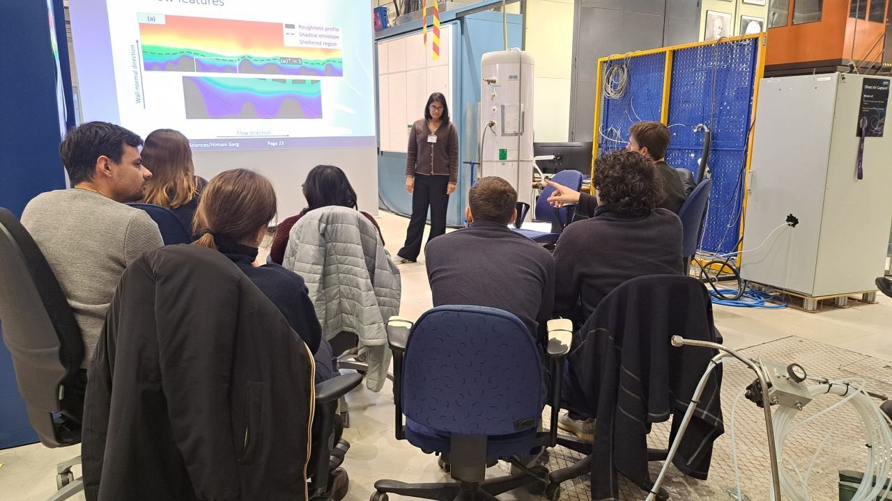
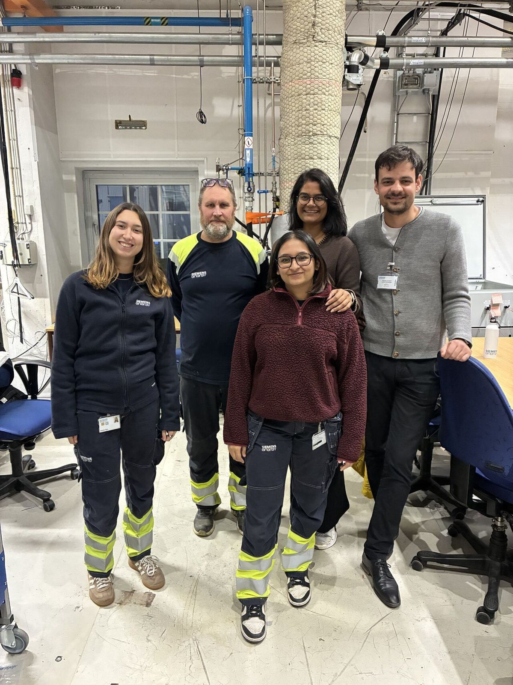

What can surface roughness tell us about heat transfer? We spent a full day exploring that question with [Mats Kinell](https://www.linkedin.com/in/mats-kinell-3111b698/), [Catarina Vieira](https://www.linkedin.com/in/catarina-vieira-478600253/), [Shruti Aaher](https://www.linkedin.com/in/shrutiaaher/) and his team at [Siemens Energy](https://www.linkedin.com/company/siemens-energy/)'s fluid dynamics lab in Finspång.

*Sharing our latest numerical advances on turbulent heat transfer over rough surfaces in the lab.*

On 26 October, my postdoc [Thomas Golliard](https://www.linkedin.com/in/thomas-golliard-0bb848108/) and I had the pleasure of sharing our latest numerical advances and hearing about the team's experimental work. The conversations sparked new ideas and gave us plenty to build on.

*With colleagues at the fluid dynamics lab in Finspång.*

Thank you to Mats Kinell and the team for such a thoughtful and welcoming exchange. We're excited to keep the collaboration moving and explore what we can work on together next.

You can read more about our work on this topic on the <a href="{{ '/research/' | relative_url }}">Research page</a>.
